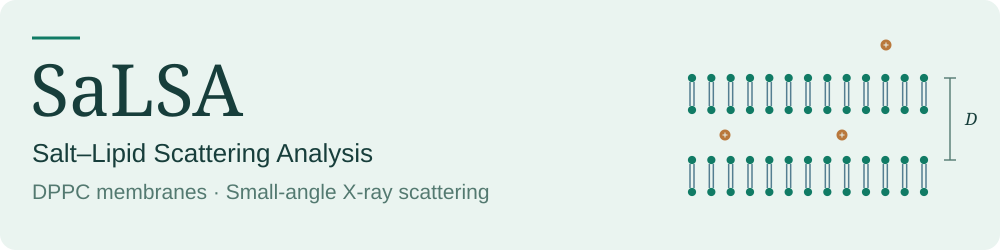
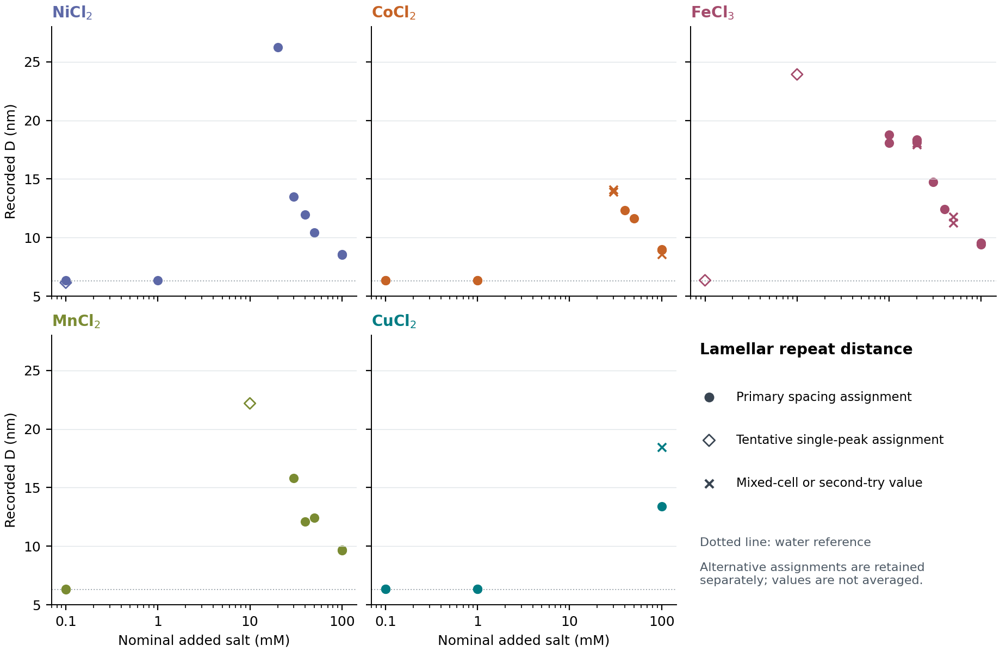

<picture>
<source media="(max-width: 520px) and (prefers-color-scheme: dark)" srcset="assets/hero-mobile-dark.svg">
<source media="(max-width: 520px)" srcset="assets/hero-mobile-light.svg">
<source media="(prefers-color-scheme: dark)" srcset="assets/hero-dark.svg">

</picture>

How do metal ions change the organization of lipid membranes? SaLSA uses small-angle X-ray scattering (SAXS) to compare DPPC in CuCl₂, CoCl₂, NiCl₂, MnCl₂ and FeCl₃ solutions across salt concentrations of 0.1–100 mM.

**Roee Tekoah, Eitan Eisenthal Berkovitz, Lea Fink, Asaf Shemesh and Uri Raviv** 
Raviv Group · Hebrew University of Jerusalem · Research conducted in 2017–2018

## ↗ Read the work

<table width="100%">
<tr><td width="84" align="center" valign="middle"><picture><source media="(prefers-color-scheme: dark)" srcset="assets/paper-dark.svg"></picture></td><td valign="middle">
<strong>The paper</strong> Ion-dependent lamellar organization of DPPC membranes: a SAXS study. Experimental methods, results, interpretation and supporting information.

<a href="output/pdf/main.pdf">Read the paper · 9 pages ↗</a>
</td></tr>
<tr><td width="84" align="center" valign="middle"><picture><source media="(prefers-color-scheme: dark)" srcset="assets/curves-dark.svg"></picture></td><td valign="middle">
<strong>The measurements</strong> Processed scattering curves across five salt series, with recorded lamellar spacings and source links.

<a href="docs/curve-atlas.md">Browse the curves ↗</a> &nbsp;·&nbsp; <a href="results/spacing-points.csv">Spacing data ↗</a>
</td></tr>
<tr><td width="84" align="center" valign="middle"><picture><source media="(prefers-color-scheme: dark)" srcset="assets/workflow-dark.svg"></picture></td><td valign="middle">
<strong>The experiment</strong> Sample preparation, SAXS measurements, background subtraction and structural analysis with X+.

<a href="docs/workflow.md">Experimental workflow ↗</a> &nbsp;·&nbsp; <a href="docs/evidence.md">Data documentation ↗</a>
</td></tr>
</table>

## ◈ Membrane organization across the salt series

The concentration series compares lamellar repeat distances and their dependence on ion identity. The paper interprets the swelling and contraction in terms of adsorption, membrane charging and electrostatic screening.

Recorded spacing assignments; tentative and alternative values are shown separately. [Figure and interpretation →](output/pdf/main.pdf#page=4)

## ⌘ Data and analysis

[Processed curves](data/series-inputs.csv), [spacing tables](results/spacing-points.csv), [source associations](data/evidence-links.csv) and [figures](figures/) accompany the manuscript. The [analysis scripts](analysis/) regenerate plots and numerical summaries from the processed inputs; the original detector integration and nonlinear X+ fits are separate steps.

**[Run the analysis →](environment/README.md)** &nbsp;·&nbsp; [Understand the data →](docs/evidence-links.md)

## ↗ Related research

The study builds on the Raviv Group’s work on ion adsorption and interactions between lipid membranes, including [Szekely et al. (2011)](https://doi.org/10.1021/la200264s) and [Fink et al. (2017)](https://doi.org/10.1021/acs.langmuir.7b00596).

**[Research context and references →](docs/research-context.md)**

---

[Cite SaLSA](CITATION.cff) · [Authors and contributions](docs/contributors.md) · Code: [MIT](LICENSES/MIT.txt) · Manuscript, figures and data: [CC BY 4.0](LICENSES/CC-BY-4.0.txt) · [License scope](LICENSE.md)
